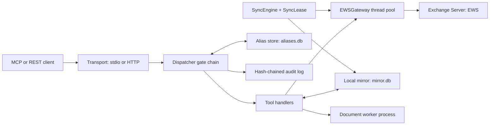
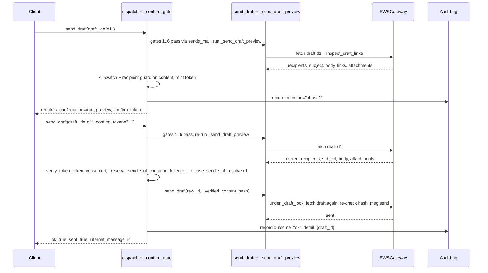

# Architecture — ews-mcp 4.5

This page explains how the 4.5 server in `v5/ewsmcp/` is put together: the runtime parts, the
exact path of a tool call, the local SQLite mirror, short aliases, hostile-input boundaries, disk
layout, and connection guards. For the invariant rules that govern changes to this code see
[../DESIGN.md](../DESIGN.md). For tool schemas see [API.md](API.md), for policy goals see
[SAFETY.md](SAFETY.md), for environment variables see [CONFIGURATION.md](CONFIGURATION.md), and
for running the server see [DEPLOYMENT.md](DEPLOYMENT.md).

The default registry exposes `18` / `29` / `34` tools across the `read` / `draft` / `full` tiers,
and `35` when `find_similar` is enabled with the semantic index.

## The shape in one picture

`ews-mcp` is an asyncio Python data plane between MCP or HTTP clients and Exchange Web Services.
It never calls a language model; summaries and judgment stay in the calling assistant.
Requests arrive over `stdio` or HTTP and enter one function, `tools/base.py::dispatch`.
Each tool is a `ToolSpec` declaring its schema and class while `dispatch` owns every policy gate.
`dispatch` checks gates, resolves aliases in `aliases.db`, runs the handler, and writes audit JSONL.
Read handlers query the local SQLite mirror `mirror.db` first and fall back to live Exchange calls.
Mutation handlers call Exchange directly and then write through to `mirror.db` best-effort.
Blocking `exchangelib` calls run in `EWSGateway` on a bounded thread pool with a 401 lockout guard.
One `SyncEngine` per `DATA_DIR`, elected by an OS lock on `sync.lock`, keeps `mirror.db` warm.
Untrusted attachment documents are parsed in a separate child process with time and memory caps.

## A tool call, step by step

Every MCP `call_tool` request and every REST `POST /api/tools/{name}` request converges on
`ewsmcp/tools/base.py::dispatch`. A tool above the server's tier is not registered: it is absent
from `ctx.registry` and the tool list, and calling it returns `validation` with
`Unknown tool: <name>`, mapped to HTTP `404` over REST. On the REST shim, oversized request bodies
and JSON Schema mismatches against `spec.public_schema()` also fail before `dispatch` with
`validation`.

Inside `dispatch`, gates execute in this exact order:

1. **Reserved-argument strip**: copies `kwargs` and pops `confirm_token` and
   `_verified_content_hash` unconditionally so handlers never see `confirm_token` and callers
   cannot forge a verified preview hash. Refusal code: none.
2. **Send kill-switch**: `ToolSpec` declares an optional `notifies(kwargs, content)` predicate for
   non-`send` tools that email people on specific paths: `create_event` for
   `send_invitations=true`, `update_event` for `notify_attendees=true`, and `cancel_event` when the
   previewed `action` is `"cancel"`. `spec.sends_mail(kwargs, content)` returns `true` when
   `side_effect_class == "send"` or `notifies` returns `true`. At this gate `dispatch` checks
   `spec.sends_mail(kwargs)`: while `SEND_ENABLED` is `false`, `send_draft`, `respond_to_event`,
   `set_oof`, `create_event(send_invitations=true)`, and `update_event(notify_attendees=true)` are
   refused immediately at phase 1 with `kill_switch` before connectivity or preview work.
   `cancel_event` depends on the fetched event and is checked via `spec.sends_mail(kwargs, content)`
   inside `_confirm_gate` at step 7, also refusing at phase 1 before any token is issued. The three
   calendar handlers keep their own `SEND_ENABLED` check as a second line.
3. **Capability tier**: maps `spec.side_effect_class` to its minimum tier — `read` to `read`,
   `write` to `draft`, and `send` or `destructive` to `full` — and compares against
   `EWS_CAPABILITY_TIER`. `tier_blocked`, mapped to HTTP `403`, is a second check inside the
   dispatcher that a client does not normally reach.
4. **Upstream circuit breaker**: when `spec.requires_ews` is `true`, checks whether
   `ctx._circuit_open_until` is still in the future and refuses with `upstream_unavailable` and
   `retry_after_s` without touching the network. Tools with `requires_ews=False` —
   `get_server_status`, `waiting_on`, and `find_similar` — still pass through and answer.
5. **Cold-start and auth gate**: runs when `spec.requires_ews` is `true` — every tool except
   `get_server_status`, `waiting_on`, and `find_similar` — and a `ConnectionManager` is attached.
   State `auth_failed` refuses with `auth_failed`; state `connecting` refuses with
   `upstream_unavailable` while initial warmup is in flight; state `degraded` lets the call try
   Exchange live.
6. **Argument recipient guard**: checks that any `to`, `cc`, `bcc`, or `attendees` argument is a
   string or list of strings, refusing other shapes with `validation`. When
   `EWS_RECIPIENT_DENYLIST` or `EWS_RECIPIENT_ALLOWLIST` is configured, it normalizes every
   address: malformed addresses refuse with `validation`, and denylisted or non-allowlisted
   addresses refuse with `recipient_blocked`.
7. **Two-phase confirmation in `_confirm_gate`**: runs when `spec.confirm_needed(kwargs)` is
   `true`. When `spec.preview` is set — on `send_draft`, `update_event` with
   `notify_attendees=true`, `cancel_event`, `save_rule`, and `delete_rule` — `_confirm_gate` awaits
   it and checks `spec.sends_mail(kwargs, content)` against `SEND_ENABLED`, so attendee
   cancellations fail with `kill_switch` at phase 1. It then re-runs `_recipient_guard` on the
   resolved recipients or stored attendees, refusing with `recipient_blocked` or `validation`,
   including stored recipients with no SMTP address when a recipient list is set. Next it hashes
   `target_id` and the preview payload; arguments outside that payload, such as `idempotency_key`,
   are not bound. Without `spec.preview`, it hashes `kwargs`. Without `confirm_token`,
   `_confirm_gate` mints an HMAC-SHA256 token and returns the phase-1 preview with `ok: true` and
   `requires_confirmation: true`. With `confirm_token`, `_confirm_gate` runs in exact
   reserve-then-consume order:
   - Verifies signature, expiry, mailbox, action, `target_id`, and content hash via `verify_token`,
     refusing any mismatch with `confirm_invalid`.
   - Checks read-only `token_consumed(token)` and refuses already-spent tokens with
     `confirm_invalid` before touching the send cap.
   - When `spec.sends_mail(kwargs, content)` is `true`, calls `_reserve_send_slot` to check the
     in-memory rolling 3,600-second `EWS_MAX_SENDS_PER_HOUR` window and reserve a slot — refusing
     with `rate_capped` before `consume_token` runs so the token stays unspent.
   - Calls `consume_token(token)` to mark the token spent; if a concurrent call consumed the token
     first, calls `_release_send_slot` to release the reserved slot and refuses with
     `confirm_invalid`.
   - Injects `_verified_content_hash` for handlers that declare it.
8. **Unconfirmed send rate cap**: when `spec.confirm_needed(kwargs)` is `false` and
   `spec.sends_mail(kwargs)` is `true` — a `send_draft` `idempotency_key` replay with a raw EWS
   `draft_id` — `dispatch` calls `_rate_guard`, which runs `_reserve_send_slot`. Refusal code:
   `rate_capped`.
9. **Alias resolution**: when `spec.resolve_ids` is `true` — every tool except `get_messages`,
   which resolves per item so one bad alias does not fail the whole batch — translates short
   aliases in `id`, `message_id`, `draft_id`, `event_id`, `thread_id`, `reply_to`, and `ids` to
   raw EWS `ItemId` strings. Folder keys in `folder` are resolved later by
   `gateway.resolve_folder`. Unknown aliases refuse with `validation`.
10. **Handler execution, error mapping, and audit**: awaits `spec.handler`, which offloads blocking
    Exchange work onto `gateway.call`. A clean return resets `ctx._circuit_failures` to `0` and
    sets `ok: true`. `ToolError` carries its own code, with `internal` used only for an unwritable
    attachments folder or an unavailable document worker, and `TypeError` and `ValueError` map to
    `validation`. Every other exception passes through `errors.map_exception` into five codes —
    `auth_failed`, `throttled`, `not_found`, `upstream_unavailable`, or `upstream_error` for
    unrecognized and unexpected local exceptions — bumping `ctx._circuit_failures` on
    `upstream_unavailable`, `upstream_error`, and `throttled`. A `finally` block increments
    `ctx.counters` and writes one best-effort audit record on a worker thread.

For error payload fields and HTTP status mappings see [API.md#error-taxonomy](API.md#error-taxonomy).

## Reading: the mirror and the live path

Read tools answer from a local SQLite mirror first whenever the mirror holds a complete answer, and
fall back to live Exchange calls otherwise. Every read response stamps `source` — `"cache"`,
`"live"`, or `"mixed"` on `get_messages` — and cached responses include `as_of` as a UTC ISO-8601
timestamp. See [API.md#cache-freshness-contract](API.md#cache-freshness-contract) for the caller
contract and [CONFIGURATION.md#the-local-mirror](CONFIGURATION.md#the-local-mirror) for mirror
settings.

`CacheStore` in `ewsmcp/cache/store.py` manages `DATA_DIR/cache/mirror.db` in SQLite WAL mode at
schema version `2`. One persistent connection writes under a threading lock, while tool calls open
short-lived read-only URI connections so reads and background sync do not block each other:

| Table | What it holds |
|---|---|
| `messages` + `messages_fts` | Synced mail headers, recipients, categories, flags, cleaned plain-text body up to `20,000` chars, and a normalized shadow column indexed by external-content FTS5 (`unicode61 remove_diacritics 2` plus symmetric Arabic folding from `ewsmcp/normalize.py`). |
| `events` | Expanded calendar entries across a rolling 14-day window, capped at `200` items, used by `get_mailbox_overview`. |
| `tasks` | Synced Exchange task rows (`subject`, `due_date`, `is_complete`, `status`). |
| `folders` | Folder tree metadata (`name`, `path`, well-known key, `folder_class`, `total`, `unread`, `children`). |
| `sync_state` | Per-scope Exchange sync state tokens and Unix `as_of` watermarks. |
| `sender_sigs` | Trailing-block hashes per sender; once a block reaches `3` hits (`SIG_MIN_HITS`), reads strip it as a learned signature. |

`SyncEngine` in `ewsmcp/cache/sync.py` starts when `ConnectionManager` first reaches `warm`:

- **Fast lane (`EWS_CACHE_SYNC_SECONDS`)**: calls Exchange `SyncFolderItems` per folder listed in
  `EWS_CACHE_FOLDERS` within `EWS_CACHE_WINDOW_DAYS`, fetching `ITEM_FIELDS` only and never raw
  MIME. When `EWS_SEMANTIC_INDEX=pgvector`, synced chunks are also embedded through
  `ewsmcp/semantic.py`.
- **Slow lane (`EWS_CACHE_HIERARCHY_SECONDS`)**: refreshes the folder tree and unread counts, the
  14-day calendar window, and `tasks` deltas.
- **Write-through**: write, move, and delete handlers execute on Exchange first and then update or
  tombstone `mirror.db` best-effort so follow-up reads do not wait for the next sync tick.

A read bypasses `mirror.db` and goes straight to Exchange in any of these cases:

- The caller passes `fresh=true`.
- `EWS_CACHE_ENABLED` is `false`, the target folder is outside `EWS_CACHE_FOLDERS`, the scope has
  no `as_of` watermark yet, or SQLite raises an error.
- The query asks for data the mirror does not store: `folder="f:all"`, `recursive=true`,
  `flag_complete`, `include_html=true`, `format="eml"`, `get_attachment`, `list_events`,
  `get_event`, `check_availability`, `find_people`, `get_contact`, `get_oof_settings`, or
  `list_rules`.

Live paged queries use `gateway.client.paginate`, which slices `offset : offset + limit + 1` to
detect `next_offset` and never calls `QuerySet.count()`.

When several local MCP clients point at the same `DATA_DIR`, `SyncLease` in
`ewsmcp/cache/lease.py` ensures only one process runs `SyncEngine`. It takes a non-blocking OS lock
on `DATA_DIR/cache/sync.lock` — `msvcrt.locking` at byte offset `1,024` on Windows so the leader
PID at byte `0` stays readable, or `fcntl.flock` on POSIX. The holder reports `role: "leader"`;
other processes report `role: "follower"`, read the shared `mirror.db`, skip
`EWS_CACHE_PURGE_ON_BOOT`, and retry the lock every `30` seconds to take over if the leader exits.
See [DEPLOYMENT.md#several-clients-on-one-machine](DEPLOYMENT.md#several-clients-on-one-machine).

## Ids and aliases

Raw EWS `ItemId` strings are 100 to 150 characters of case-sensitive base64. Passing them through a
model wastes context tokens, invites single-character transcription mistakes, and breaks references
whenever moving a message assigns a new `ItemId`. `ewsmcp/ids.py` replaces them at the boundary
with short typed aliases while still accepting raw EWS ids on input. See [API.md#ids](API.md#ids).

| Prefix | Example | What it identifies |
|---|---|---|
| `m` | `m12` | Mail message `ItemId` |
| `d` | `d1` | Draft message `ItemId` |
| `a` | `a1` | Attachment `AttachmentId` |
| `e` | `e3` | Calendar event `ItemId` |
| `t` | `t4` | Conversation `ConversationId` |
| `p` | `p2` | Person or contact (`Contact` `ItemId` or person e-mail address) |
| `k` | `k1` | Task `ItemId` |
| `f` | `f7`, `f:inbox`, `f:all` | Folder `FolderId` (`f7`), `WELL_KNOWN` folder keys in `ewsmcp/gateway/client.py`, or `f:all` in `ewsmcp/tools/mail_read.py` |
| `r` | `r1` | Inbox rule `RuleId` |

`ids.kind_for_key` also reserves `c` for `contact_id` and `x` for unmapped keys, though current
people tools mint `p` aliases.

Aliases live in `DATA_DIR/memory/aliases.db` in SQLite WAL mode alongside optional `changekey` and
`internet_message_id` columns. List tools pre-mint an entire page in a single `BEGIN IMMEDIATE`
transaction on a worker thread via `IdAliaser.alias_many`. When `move_messages` moves an item and
Exchange returns a new `ItemId`, `IdAliaser.rebind` points the existing `m` alias at the new raw
id. If `aliases.db` cannot open at startup, `NullAliaser` passes raw EWS ids through so the server
still boots.

On input, strings that do not match `^[a-z]{1,2}[0-9]+$` pass through `IdAliaser.resolve` unchanged
as raw EWS ids. A short alias missing from `aliases.db` raises `KeyError`; gate 9 turns that into
`validation` with a hint to re-search, while `get_messages`, `save_rule`, and `delete_rule` resolve
their own targets and report unknown aliases as `not_found`.

## What the model receives

Tool handlers never serialize `exchangelib` objects directly. `ewsmcp/dto.py` projects Exchange
records into compact dictionaries, drops null or default flags, and wraps every list response in
`dto.envelope` with keys `ok`, `items`, `count`, `total_available`, and `next_offset`. See
[API.md#the-canonical-envelope](API.md#the-canonical-envelope).

| Shape | Returned by | Contents |
|---|---|---|
| `msg_card` | `search_messages`, `get_mailbox_overview` | `id`, `from`, `subject`, `date`, 200-char latest-reply `snippet`, and sparse flags (`thread`, `to_count`, `unread`, `attach`, non-normal `importance`) — roughly 60 tokens per item. |
| `msg_full` | `get_message`, `get_messages`, `get_thread` | Card fields without `snippet`, `to`, `cc`, cleaned `body`, attachment inventory (`idx`, `name`, `size_bytes`, `content_type`, optional `smime_type`), `internet_message_id`, and live `flag_complete`. Raw HTML is included only when `get_message` is called with `include_html=true`. |
| `eml` export | `get_message(format="eml")` | Writes RFC-822 `mime_content` to `DATA_DIR/attachments/` and returns `saved_path` and `size_bytes`; raw MIME bytes never enter tool JSON. |

Message and calendar body text comes from Exchange's plain-text `text_body` property whenever
Exchange supplies one. Mirror sync fetches `text_body` exclusively and never converts HTML. Only
when `text_body` is empty on a live `get_message`, `get_messages`, or `get_event` call — plus on
`get_oof_settings` replies and HTML attachments — does the server fall back to
`bodyclean.html_to_text_bounded`.

`bodyclean.clean_body` then normalizes newlines, strips English and Arabic quoted reply chains via
`strip_quoted_history`, removes trailing sign-off blocks via `strip_signature` and repeated
per-sender blocks learned by the mirror via `strip_learned_signature`, collapses blank runs, and
truncates on a word boundary:

| Field or slice | Limit | Source |
|---|---|---|
| `msg_card.snippet` | `200` chars | Fixed in `ewsmcp/dto.py` |
| `msg_full.body` (`get_message`, `get_messages`) | `BODY_MAX_CHARS` | Configurable; see [CONFIGURATION.md#response-size](CONFIGURATION.md#response-size) |
| `get_event` `event.body` | `2,000` chars | Fixed in `ewsmcp/tools/calendar_people.py` |
| Mirrored `messages.body_clean` | `20,000` chars | `BODY_CLEAN_MAX` in `ewsmcp/cache/sync.py` |
| `get_attachment(mode="text")` slice | `20,000` chars per call up to `5,000,000` extracted chars | Paged with `offset`, backed by an in-memory LRU cache (`AttachmentTextCache`: up to `4` docs, `8,000,000` chars, `600` s TTL); see [API.md#reading-attachments](API.md#reading-attachments) |

## Writing and sending

Ordinary mail leaves the mailbox only through `send_draft` and is strictly draft-first:
`create_draft` saves into `f:drafts`, while `update_draft`, `add_draft_attachment`, `delete_draft`,
and `send_draft` verify via `_require_in_drafts` that the target item currently lives in
`f:drafts`, refusing any message in Inbox, Sent, or Archive. Meeting mail — invitations, update
notices, responses, and cancellations — is sent by the calendar tools:

| Tool | What it can send | Minimum tier | Refused while `SEND_ENABLED=false` | Two-phase confirmation | Counted by `EWS_MAX_SENDS_PER_HOUR` | Recipients checked against the lists |
|---|---|---|---|---|---|---|
| `send_draft` | The draft | `full` | Yes | Always | Yes | Arguments and the stored draft |
| `respond_to_event` | A meeting response | `full` | Yes | Always | Yes | n/a |
| `set_oof` | Automatic replies, when enabled | `full` | Yes | Always | Yes | n/a |
| `create_event` with `send_invitations=true` | Invitations | `draft` | Yes | Yes | Yes | The `attendees` argument |
| `update_event` with `notify_attendees=true` | Update notices | `draft` | Yes | Yes | Yes | The attendees stored on the event |
| `cancel_event` on a meeting with attendees | Cancellation notices with the caller's `message` | `full` | Yes | Always | Yes | The attendees stored on the event |
| `cancel_event` on an appointment without attendees | Nothing; moves it to Deleted Items | `full` | No | Always | No | n/a |
| `delete_messages` | Nothing | `full` | No | For `disposition="permanent"` | No | n/a |

While `SEND_ENABLED` is `false`, nothing in this table that sends is allowed: every sending call is
refused with `kill_switch` at phase 1 before any token is issued. Invitations and update notices
need only tier `draft`, `SEND_ENABLED=true`, and a confirmation. The hourly cap counts every
confirmed call that sends in an in-memory per-process window that resets on restart. At phase 2 a
send slot is reserved after `verify_token` and `token_consumed` and before `consume_token` — and
released if `consume_token` finds the token was concurrently spent — so a `rate_capped` refusal
leaves the token unspent.

Two-phase confirmation uses stateless HMAC-SHA256 signing in `ewsmcp/confirm.py` via `content_hash`,
`make_token`, `verify_token`, `token_consumed`, and `consume_token`, paired with
`ewsmcp/tools/base.py::preview_content_hash`. Phase 1 hashes the bound content and signs
`{m: mailbox, a: action, t: target_id, c: chash, e: exp}` with `SEND_CONFIRM_SECRET` — or a random
32-byte per-process secret when unset — valid for `CONFIRM_TTL_SECONDS`. Phase 2 verifies every
signed field and marks the token spent in an in-memory single-use set via `consume_token`, keeping
spent records for `CONSUMED_GRACE_SECONDS` — `5` seconds — past expiry so a spent token stays
refused through the end of its lifetime. See
[API.md#two-phase-confirmation](API.md#two-phase-confirmation) and
[SAFETY.md#two-phase-confirmation](SAFETY.md#two-phase-confirmation).

| Confirmed tool | What `preview_content_hash` / `content_hash` binds | Phase-2 execution guard |
|---|---|---|
| `send_draft` | Resolved `subject`, sorted `to`, `cc`, and `bcc`, full `body_text` and `_body_html`, and attachment metadata (`name`, `size`, `id`; attachment byte contents are not hashed). | Re-runs `_send_draft_preview`, then under `_draft_lock` fetches the draft again, re-checks the hash, and calls `msg.send(save_copy=True)`. |
| `update_event` with `notify_attendees=true` | `event_id`, resolved `target_id`, `scope`, `notify_attendees`, `type`, current `subject`, `location`, `start`, and `end`, `attendee_count`, sorted stored `attendees`, and every requested change including the full `body`. | Re-runs `_update_event_preview` and re-fetches via `_fetch_update_target` in `_update_event`, refusing with `confirm_invalid` without saving if the stored event, attendees, or arguments changed. |
| `cancel_event` | `event_id`, resolved `action` (`cancel` or `delete`), `subject`, `start`, `end`, `type`, `series`, `is_meeting`, `attendee_count`, sorted `attendees`, and `message`. | Re-fetches the calendar item and refuses with `confirm_invalid` if organizer status, attendees, times, or arguments changed. |
| `save_rule`, `delete_rule` | Planned rule, raw target `FolderId` values, replaced or deleted rule, SHA-256 fingerprint of raw `GetInboxRules` XML, and `outlook_only_rules`. | Serializes under `_rules_lock` and refuses with `confirm_invalid` if server-side rules drifted since phase 1. |
| `respond_to_event`, `set_oof`, `delete_messages(disposition="permanent")`, `create_event(send_invitations=true)` | Canonical JSON of the call arguments. | Dispatcher verifies the argument hash matches `confirm_token` before calling the handler. |

#### `send_draft`

- Phase 2 re-runs `_send_draft_preview` to verify the token, then acquires per-draft `_draft_lock`,
  fetches the draft again, re-computes and compares the hash, and calls `msg.send(save_copy=True)`
  on that object.
- Optional `idempotency_key` caches sent receipts in memory for `48` hours, up to `512` keys max.
- A retry with the same `idempotency_key` is recognized as a replay and answered with
  `replayed: true` without sending again only when `draft_id` is the raw EWS id. With a `d` alias
  the retry is treated as a new call and fails because the sent draft is no longer in Drafts.

#### `update_event`

- Both `_update_event_preview` and `_update_event` fetch the whole calendar item through one
  helper, `_fetch_update_target`, so phase 1 and phase 2 see the same event, all-day events
  included.

## Hostile input: HTML, documents and message bodies

Content written by strangers enters the server in three places: HTML draft bodies and stored drafts
inspected before send, email attachments read as text, and HTML message bodies lacking a plain-text
part. None of the three uses Python's `html.parser`, and document parsing runs outside the server
process:

| Surface | Modules | When it runs | What it holds to |
|---|---|---|---|
| Draft HTML and send-time link inspection | `ewsmcp/htmlsafe.py` | Off the event loop on `create_draft` / `update_draft` with `body_format="html"` and on `send_draft` phase 1 | Custom linear-time non-raising stdlib tokenizer; allow-list HTML rebuild in `sanitise_html` and eight-reading URL/mismatch scan in `inspect_draft_links` with bounded runtime and GIL hold. |
| Attachment documents (`pdf`, `docx`, `xlsx`, `pptx`, `eml`, `message`, `html`) | `ewsmcp/extract_worker.py`, `ewsmcp/extract_child.py`, `ewsmcp/extract.py`, `ewsmcp/pdftext.py` | Per document in `get_attachment` (`text` attachments slice in-process without spawning a child) | Isolated `python -m ewsmcp.extract_child` subprocess per document with OS memory and timeout caps, `defusedxml` and bounded in-memory readers, and strict JSON output validation; isolates crashes, not OS user access. |
| Fallback HTML-to-text on bodies | `ewsmcp/bodyclean.py` | When `text_body` is empty on live `get_message`, `get_messages`, or `get_event`, on `get_oof_settings`, and inside the worker for HTML attachments | Single-pass linear-time non-raising stdlib tokenizer in `html_to_text_bounded`; closes hidden regions by HTML5 browser rules and renders rather than hides ambiguous containers. |

#### `ewsmcp/htmlsafe.py`

- `sanitise_html` rebuilds `<html><body…>…</body></html>` from element, attribute, URL-scheme —
  `http`, `https`, and `mailto` — and CSS allow-lists to a fixed point, dropping `img`, scripts,
  styles, forms, SVG/MathML, and bidi overrides.
- `inspect_draft_links` unions attribute URLs with eight character-reference and whitespace
  readings of raw markup so destination hosts and label-vs-URL mismatches surface in bounded time
  and GIL hold.

#### `ewsmcp/extract_worker.py` and `ewsmcp/extract_child.py`

- Spawns a fresh `python -m ewsmcp.extract_child` process with a scrubbed environment — no `EWS_*`,
  `MCP_*`, `SEND_*`, or secret/key variables — and an empty temporary working directory.
- Applies an OS virtual-memory cap before reading `stdin` via Win32 Job Object or Linux `RLIMIT_AS`,
  plus a hard wall-clock timeout, a 75% soft deadline for partial text, and kill-on-close Job
  Object or POSIX process-group kill.
- Parses in memory with `defusedxml` and bounded ZIP/XML/PDF/MIME readers, and validates child JSON
  keys and types strictly in the parent.
- On Linux, the parent server marks itself non-dumpable via `PR_SET_DUMPABLE=0` before spawning its
  first worker unless `EWS_KEEP_DUMPABLE=true`.
- Isolates time, memory, and parser crashes, not OS user or filesystem access.

#### `ewsmcp/bodyclean.py`

- `html_to_text_bounded` closes hidden regions — `<!-- -->`, `<head>`, `<title>`, `<script>`
  double-escape, `<style>`, CDATA, and `<svg>`/`<math>` breakouts — by HTML5 browser rules.
- Renders rather than hides ambiguous containers: `iframe`, `noembed`, `noframes`, and `template`.

Exact byte, page, element, timeout, and memory ceilings live in
[API.md#draft-bodies](API.md#draft-bodies) and
[API.md#reading-attachments](API.md#reading-attachments). Threat boundaries and explicit
non-promises live in [SAFETY.md#html-drafts](SAFETY.md#html-drafts),
[SAFETY.md#attachments-and-message-bodies](SAFETY.md#attachments-and-message-bodies), and
[SAFETY.md#what-is-not-promised](SAFETY.md#what-is-not-promised).

## Transports

`ewsmcp/main.py` loads `Settings`, configures `stderr` logging, and dispatches to
`server.run_stdio` or `http.serve_http`. Each transport builds `Context` via
`ewsmcp/server.py::build_context` and schedules `ConnectionManager`'s background warmup task
without waiting for an Exchange probe to succeed, so startup never blocks on Exchange. If opening
`aliases.db`, the audit directory, `mirror.db`, `sync.lock`, or the semantic index fails,
`build_context` logs an error and falls back to degraded pass-through components rather than
exiting. While warmup runs in the background, the server already answers `get_server_status` and
HTTP health probes.

`MCP_TRANSPORT` selects one of two front ends:

- **`stdio` in `ewsmcp/server.py::run_stdio`**: the default mode; runs
  `mcp.server.stdio.stdio_server` over standard input and output. `main.py` directs all logging to
  `sys.stderr` so JSON-RPC frames on `stdout` are never mixed with log lines.
- **`http` in `ewsmcp/http.py::serve_http`**: runs `uvicorn` with `http="h11"` around the custom
  ASGI application `build_app`, mounting `StreamableHTTPSessionManager` with `stateless=True` at
  `/mcp` alongside a REST shim and operational probes.

| HTTP path | Auth | Purpose |
|---|---|---|
| `GET /livez`, `GET /health`, `GET /version` | Public | Process liveness, tool-count snapshot, and server version. |
| `GET /readyz` | Public | Returns `200` when `ConnectionManager` is `warm` (or unmanaged in tests) and `503` when `connecting`, `degraded`, or `auth_failed`. |
| `/.well-known/*`, `/register` | Public (`404`) | Explicit `404` before API-key checks so MCP clients do not mistake static bearer auth for OAuth discovery. |
| `/mcp` | `MCP_API_KEY` when set | Streamable HTTP MCP endpoint with request body size capped by `http.max_body_bytes` from `EWS_MAX_ATTACHMENT_MB`. |
| `GET /api/tools`, `POST /api/tools/{name}`, `GET /openapi.json` | `MCP_API_KEY` when set | JSON REST shim for scripts and OpenAPI importers; validates arguments against `spec.public_schema()` and maps tool errors via `HTTP_BY_CODE`. |
| `GET /metrics` | `MCP_API_KEY` when set | Prometheus text `0.0.4` counters and gauges (`ewsmcp_uptime_seconds`, `ewsmcp_connection_warm`, `ewsmcp_auth_failed`, `ewsmcp_auth_rejections`, `ewsmcp_tool_calls_total`, `ewsmcp_errors_total`, plus cache, sync, and semantic gauges). |

When `MCP_API_KEY` is set, non-public routes require `Authorization: Bearer <key>` or
`X-API-Key: <key>` checked with `hmac.compare_digest`; when `MCP_API_KEY` is unset or empty, no
HTTP authentication is enforced. See [DEPLOYMENT.md#http-server](DEPLOYMENT.md#http-server) and
[DEPLOYMENT.md#health-readiness-and-metrics](DEPLOYMENT.md#health-readiness-and-metrics).

## What is stored on disk

All local persistent state lives under `DATA_DIR`, which defaults to `~/.ewsmcp` when unset; when
`EWS_SEMANTIC_INDEX=pgvector` is enabled, item ids and body-chunk embeddings are also stored in
PostgreSQL table `ews.message_embeddings`. Startup resolves `DATA_DIR` to an absolute path and refuses
directories whose path contains `onedrive`, `dropbox`, `google drive`, `googledrive`, or `icloud`
unless `DATA_DIR_ALLOW_SYNCED=true`. See
[SAFETY.md#what-is-stored-and-where](SAFETY.md#what-is-stored-and-where) and
[DEPLOYMENT.md#the-data-directory](DEPLOYMENT.md#the-data-directory).

| Path under `DATA_DIR` | What it holds | Contains mail? |
|---|---|---|
| `memory/aliases.db` (plus `-wal`, `-shm`) | Bidirectional mapping between short aliases and raw EWS `ItemId`, `changekey`, and `internet_message_id`, plus per-kind sequence counters. | Ids only, including `internet_message_id`, plus the e-mail addresses of people returned by `find_people`; no subjects or bodies. |
| `cache/mirror.db` (plus `-wal`, `-shm`) | Local SQLite mirror (`messages`, `messages_fts`, `events`, `tasks`, `folders`, `sync_state`, `sender_sigs`). Not created when `EWS_CACHE_ENABLED=false`. | **Yes** — subjects, sender and recipient addresses, cleaned plain-text bodies, calendar subjects/locations, and task titles. |
| `cache/sync.lock` | Lock file written by `SyncLease` with the leader PID at byte `0`. | No. |
| `audit/audit-YYYYMMDD.jsonl`, `audit/chain.state` | Daily append-only SHA-256 hash-chained tool call records (`ts`, `tool`, `class`, `outcome`, `latency_ms`, `transport`, `seq`, `prev`, `h`) and the latest `{prev, seq}` head. | **No** — records the target ids of the call (`draft_id`, `event_id`, `ids`); recipients, subjects, and bodies are not logged. |
| `attachments/<filename>` | Files written only when `get_attachment(mode="save")` or `get_message(format="eml")` is called, suffixed `-2`, `-3`, … rather than overwriting. | **Yes**, when those modes are called — raw attachment bytes or exported `.eml` messages. |

Each audit line carries the hash of the line before it. The verifier in
`scripts/verify_audit_chain.py` detects accidental damage and edits that leave `chain.state` alone;
it is not protection against someone who can write to `DATA_DIR`, because the chain has no secret
key and can be recomputed. Several processes sharing one `DATA_DIR` break the chain by themselves,
so verify only where one process writes. Audit writes are best-effort: a failed write does not fail
the tool call.

Outside `DATA_DIR` and optional `pgvector`, confirmation tokens, `send_draft` idempotency receipts,
and `AttachmentTextCache` entries live in process memory only. `extract_worker` creates an empty
`ewsmcp-extract-*` directory in the OS temporary folder as the child process working directory and
deletes it on child exit; attachment bytes stream over pipes and are not written there.

## Staying connected: breaker, lockout guard, retries

Three separate mechanisms keep transient Exchange faults from hanging callers and keep bad
credentials from locking an Active Directory account. For every setting's default and bounds see
[CONFIGURATION.md#reliability](CONFIGURATION.md#reliability); for lockout policy see
[SAFETY.md#the-lockout-guard](SAFETY.md#the-lockout-guard).

### Connection manager

`ConnectionManager` in `ewsmcp/gateway/connection.py` owns the lifecycle of the Exchange session
across four states:

| State | How it enters | Effect on probes and tool calls |
|---|---|---|
| `connecting` | Initial startup only, before the first probe succeeds | `_warmup_loop` probes Exchange with full-jitter backoff up to `EWS_WARMUP_MAX_BACKOFF_SECONDS`. Tools with `requires_ews=True` refuse at gate 5 with `upstream_unavailable`; `/readyz` returns `503`. |
| `warm` | `test_connection()` succeeds | Starts `SyncEngine` on the first transition and runs `_heartbeat_loop` every `EWS_HEARTBEAT_SECONDS`. `/readyz` returns `200`. |
| `degraded` | A heartbeat fails with a non-auth transient error | Re-arms `_warmup_loop` in the background; `/readyz` returns `503`, while tool calls still try live Exchange so brief network blips can recover inline. |
| `auth_failed` | `test_connection()` or `AuthBreaker` reports rejected credentials | Tools with `requires_ews=True` refuse at gate 5 with `auth_failed` (including `retry_after_s` until latched permanent); `/readyz` returns `503`. |

#### `connecting`

- `_warmup_loop` probes `gateway.test_connection()`, which calls `account.root.refresh()` for a
  live `GetFolder` round trip, with full-jitter backoff up to `EWS_WARMUP_MAX_BACKOFF_SECONDS`.
- Every `3` consecutive transient failures, warmup resets the cached `Account` and
  `CachingProtocol` pool before retrying.
- Tools with `requires_ews=True` refuse at gate 5 with `upstream_unavailable`, and `/readyz`
  returns `503`.

### Gateway retries and the lockout guard

`EWSGateway` in `ewsmcp/gateway/client.py` runs every blocking `exchangelib` operation on a
`ThreadPoolExecutor` capped at `EWS_MAX_CONCURRENCY` with socket timeout `REQUEST_TIMEOUT`. By
default `exchangelib` negotiates the HTTP authentication scheme offered by Exchange;
`EWS_AUTH_TYPE_FORCE` pins `basic`, `ntlm`, or `digest` when needed.

`RejectingFaultTolerance` splits transient faults from credential rejections:

- **Transient faults**: `HTTP 503`, SOAP `ErrorServerBusy`, and connection resets are retried
  inside `exchangelib` with backoff up to `EWS_RETRY_MAX_WAIT_SECONDS`.
- **Credential rejections**: any HTTP `401`, including `"currently locked out"` bodies, is never
  retried. `RejectingFaultTolerance` records the rejection on `AuthBreaker` and raises
  `UnauthorizedError` immediately so a single call cannot spend multiple Active Directory bad
  password attempts.

`AuthBreaker` sits inside `EWSGateway.account()`, so every path to Exchange — tool handlers,
warmup, heartbeat, and `SyncEngine` — shares one guard. Each rejection opens a cooldown for
`EWS_AUTH_FAILURE_COOLDOWN_SECONDS`. After cooldown expires, `AuthBreaker` enters a half-open state
that lets a single caller run an explicit `account.root.refresh()` probe before admitting traffic;
a successful probe resets the rejection count to `0`. Once rejections since the last successful
login reach `EWS_AUTH_MAX_REJECTIONS` — counting concurrent in-flight requests that each sent bad
credentials — `AuthBreaker` latches `permanent=True` and refuses every Exchange access until
credentials are corrected and the process restarts.

### Dispatcher upstream circuit breaker

Independently of credential state, `dispatch` in `ewsmcp/tools/base.py` counts consecutive failures
of kind `upstream_unavailable`, `upstream_error` — which includes unexpected local exceptions
routed through `map_exception` — or `throttled`. Results with `validation`, `not_found`, or
`internal` — used only for an unwritable attachments folder or an unavailable document worker — do
not increment the counter. Reaching `CIRCUIT_FAILURE_THRESHOLD` resets the counter and opens
`ctx._circuit_open_until` for `CIRCUIT_OPEN_SECONDS`. While open, tools that need Exchange are
refused at gate 4 with `upstream_unavailable` and `retry_after_s`, while `get_server_status`,
`waiting_on`, and `find_similar` still answer. While open, `get_server_status.connection` also
includes `circuit_open: true` and `retry_after_s`, and the circuit closes once
`CIRCUIT_OPEN_SECONDS` have passed.

## Code map

Every Python module under `v5/ewsmcp/`:

| Module | Responsibility |
|---|---|
| `ewsmcp/__init__.py` | Package marker and `__version__` string. |
| `ewsmcp/main.py` | CLI entrypoint (`ewsmcp`): loads `Settings`, configures `stderr` logging, and dispatches to `run_stdio` or `serve_http`. |
| `ewsmcp/server.py` | Builds `Context`, provides `_NullAudit`, wires background connection and sync lifecycles, and serves MCP over `stdio`. |
| `ewsmcp/http.py` | ASGI application for HTTP mode: `/mcp`, REST shim `/api/tools/*`, `/openapi.json`, health probes, `/metrics`, and `max_body_bytes`. |
| `ewsmcp/config.py` | `Settings` (`pydantic-settings`), `EWS_AUTH_TYPE_FORCE` normalization, and the `DATA_DIR` cloud-sync guard. |
| `ewsmcp/audit.py` | Daily JSONL audit writer with persisted SHA-256 hash chaining (`chain.state`). |
| `ewsmcp/confirm.py` | Stateless HMAC-SHA256 confirmation tokens, canonical `content_hash`, and single-use consumption tracking (`token_consumed`, `consume_token`). |
| `ewsmcp/dates.py` | Parses `today`, `+Nd`, `YYYY-MM-DD`, and ISO date-time strings into timezone-aware `datetime` values in `EWS_TZ`. |
| `ewsmcp/dto.py` | Projects messages, events, people, tasks, folders, and rules into token-lean dicts and canonical list envelopes. |
| `ewsmcp/errors.py` | Maps `exchangelib`, timeout, and socket exceptions into five `ToolError` codes via `map_exception`. |
| `ewsmcp/toolerror.py` | Dependency-free `ToolError` exception (`to_dict`, `http_status`) and the twelve-code `HTTP_BY_CODE` map. |
| `ewsmcp/flag_property.py` | Registers the MAPI `flag_status` extended property (`0x1090`) on `exchangelib.Message` at import time. |
| `ewsmcp/ids.py` | SQLite-backed short alias store (`IdAliaser`), batch minting, move rebinding, and `NullAliaser`. |
| `ewsmcp/normalize.py` | Symmetric Arabic orthography and digit folding (`normalize_ar`) shared by FTS5 indexing and search queries. |
| `ewsmcp/semantic.py` | Optional `SemanticIndex` protocol, `PgVectorSemanticIndex` backed by Postgres + Ollama, `rrf_merge`, and `build_semantic_index`. |
| `ewsmcp/bodyclean.py` | Quote and signature stripping, word-boundary truncation, and the linear-time `html_to_text_bounded` converter. |
| `ewsmcp/htmlsafe.py` | Allow-list HTML sanitizer for draft bodies and eight-reading URL/mismatch inspector for `send_draft` previews. |
| `ewsmcp/extract.py` | Bounded in-memory text extractors for PDF, Word, Excel, PowerPoint, `.eml`, attached messages, HTML, and plain text. |
| `ewsmcp/extract_child.py` | Isolated child-process entrypoint (`python -m ewsmcp.extract_child`) enforcing memory and soft/hard time ceilings. |
| `ewsmcp/extract_worker.py` | Parent supervisor that marks Linux servers non-dumpable, spawns `extract_child` with OS job/session limits and scrubbed env, and validates output. |
| `ewsmcp/pdftext.py` | Post-processes `pypdf` output, repairing custom `ToUnicode` maps, reversed RTL runs, and Arabic Presentation Forms. |
| `ewsmcp/cache/__init__.py` | Re-exports `CacheStore`, `SyncEngine`, and `SyncLease`. |
| `ewsmcp/cache/lease.py` | Cross-platform non-blocking `sync.lock` lease electing one sync leader per `DATA_DIR`. |
| `ewsmcp/cache/store.py` | SQLite WAL mirror schema, FTS5 search, overview/thread/waiting-on queries, write-through helpers, and learned signatures. |
| `ewsmcp/cache/sync.py` | Two-lane background `SyncEngine` pulling mail, folder, calendar, and task deltas into `CacheStore`. |
| `ewsmcp/gateway/__init__.py` | Re-exports `EWSGateway` and `ConnectionManager`. |
| `ewsmcp/gateway/client.py` | Thread-pooled `exchangelib` wrapper, `RejectingFaultTolerance`, `AuthBreaker`, `WELL_KNOWN` folder resolver, and `paginate`. |
| `ewsmcp/gateway/connection.py` | Background warmup and heartbeat state machine (`connecting`, `warm`, `degraded`, `auth_failed`). |
| `ewsmcp/gateway/rules.py` | Synchronous Exchange Inbox rules helpers wrapping `GetInboxRules`, `CreateInboxRule`, `SetInboxRule`, and `DeleteInboxRule`. |
| `ewsmcp/tools/__init__.py` | Builds the tier-filtered `ctx.registry` via `build_registry(ctx)` across the five packs plus optional `find_similar`. |
| `ewsmcp/tools/base.py` | `ToolSpec` (`notifies`, `sends_mail`), `Context`, `preview_content_hash`, and the single `dispatch` gate chain. |
| `ewsmcp/tools/mail_read.py` | Eight mail-read tools, multi-folder fan-out, `.eml` export, attachment worker integration, and `find_similar`. |
| `ewsmcp/tools/calendar_people.py` | Seven read tools covering calendar views, free/busy slot search, GAL/contacts lookup, OOF state, and `get_server_status`. |
| `ewsmcp/tools/tasks.py` | `list_tasks`, `update_task`, and the mirror-backed `waiting_on` query. |
| `ewsmcp/tools/writes.py` | Thirteen draft, message, calendar, send, destructive, and OOF mutation tools plus their phase-1 preview builders. |
| `ewsmcp/tools/rules.py` | `list_rules`, `save_rule`, and `delete_rule` with rule validation and XML fingerprint drift checks. |

Four companion scripts in `v5/scripts/` support CI and operations:

- `dump_tool_table.py` generates and checks the tool summary and parameter tables in
  `v5/docs/API.md`.
- `boot_smoke.py` verifies cold-boot behavior against an unreachable Exchange endpoint.
- `live_smoke.py` runs a read-only live smoke journey — with optional `--write` draft creation and
  deletion — against a running HTTP server.
- `verify_audit_chain.py` verifies audit JSONL hash chains offline.

## The rules and their tests

[../DESIGN.md](../DESIGN.md) states the architectural rules as hard invariants, and the test suite
under `v5/tests/` plus `.github/workflows/v5-tests.yml` enforces them on every change:

| Rule in `DESIGN.md` | Enforced by |
|---|---|
| One gate chain in exact order; policy gates (`kill_switch`, `tier_blocked`) run before connectivity (`upstream_unavailable`, `auth_failed`) | `v5/tests/test_dispatcher.py`, `v5/scripts/boot_smoke.py` |
| Safety metadata is declared on `ToolSpec` (`side_effect_class`, `confirm`, `preview`), and handlers run behind `dispatch` rather than duplicating policy | `v5/tests/test_writes.py` (`test_pack_surface_classes_and_confirm_declarations`), `v5/tests/test_dispatcher.py` |
| Zero `exchangelib` imports inside function bodies across `v5/ewsmcp/`, and stdlib-only startup in `extract_child.py` | `v5/tests/test_no_lazy_imports.py`, `v5/tests/test_mail_read.py` |
| Every `exchangelib` signature, field name, and behavior relied on by handlers is pinned against the installed library | `v5/tests/test_exchangelib_signatures.py` |
| Generated tool summary and parameter sections in `v5/docs/API.md` match the pack specs byte-for-byte | `v5/scripts/dump_tool_table.py --check` |
| Wall-clock cost bounds scale by one shared multiplier `TIME_MARGIN` (`EWS_TEST_TIME_MARGIN`, default `3`) | `v5/tests/conftest.py`, `v5/tests/test_htmlsafe.py`, `v5/tests/test_bodyclean.py`, `v5/tests/test_extract.py`, `v5/tests/test_pdftext.py`, `v5/tests/test_mail_read.py`, `v5/tests/test_writes.py`, `v5/tests/test_north_star.py` |
| Every list tool returns the canonical `{ok, items, count, total_available, next_offset}` envelope | `v5/tests/test_envelope_contract.py` |
| A morning brief completes in `<= 2` calls and `< 2,000` response tokens | `v5/tests/test_north_star.py` |
| Arabic orthography folding is symmetric across mirror indexing and search queries | `v5/tests/test_arabic_search.py` |
| HTTP `401` never retries inside `exchangelib`, opens cooldown, and latches after `EWS_AUTH_MAX_REJECTIONS` | `v5/tests/test_auth_lockout_guard.py`, `v5/tests/test_gateway.py` |
| Audit hash chains survive restarts, and tamper detection catches edited or truncated records | `v5/tests/test_audit_persistence.py`, `v5/scripts/verify_audit_chain.py` |
| Only one process per `DATA_DIR` runs `SyncEngine`, and followers promote cleanly when the leader exits | `v5/tests/test_sync_lease.py` |
| REST shim enforces JSON Schema, request body caps, and `404` on OAuth discovery paths | `v5/tests/test_http_shim.py` |
