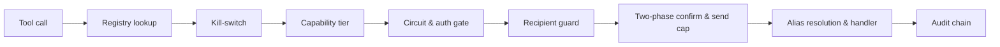

# Safety model

An assistant connected to a mailbox reads messages written by strangers and holds tools that can
change or send mail. This page explains what stops a mistaken tool call or a hostile message from
doing harm, how to configure each control, and where the server's guarantees stop.

## What the server protects

Tools above the server's capability tier are omitted when the registry is built, so clients do not
see them and cannot call them. Every registered call then passes through one central gate chain in
`ewsmcp/tools/base.py::dispatch` before reaching Exchange. Each `ToolSpec` declares its
`side_effect_class`, `confirm`, `preview`, and `notifies` metadata (`ToolSpec.sends_mail()`), while
the three notifying calendar handlers keep a second-line check of their own.



| tool | what it can send | minimum tier | refused while `SEND_ENABLED=false` | two-phase confirmation | counted by `EWS_MAX_SENDS_PER_HOUR` | recipients checked against the lists |
|---|---|---|---|---|---|---|
| `send_draft` | the draft | `full` | yes, at phase one | always | yes | arguments and the stored draft |
| `respond_to_event` | a meeting response | `full` | yes, at phase one | always | yes | n/a |
| `set_oof` | automatic replies, when enabled | `full` | yes, at phase one | always | yes | n/a |
| `create_event` with `send_invitations=true` | invitations | `draft` | yes, at phase one | yes | yes | the `attendees` argument |
| `update_event` with `notify_attendees=true` | update notices | `draft` | yes, at phase one | yes | yes | the attendees stored on the event |
| `cancel_event` on a meeting with attendees | cancellation notices with the caller's `message` | `full` | yes, at phase one | always | yes | the attendees stored on the event |
| `cancel_event` on an appointment without attendees | nothing (moves it to Deleted Items) | `full` | no | always | no | n/a |
| `delete_messages` | nothing | `full` | no | for `disposition="permanent"` | no | n/a |

- Ordinary mail leaves the mailbox only through `send_draft`. Meeting mail — invitations, update
  notices, responses, and cancellations — is sent by the calendar tools.
- While `SEND_ENABLED` is `false`, nothing in this table that sends is allowed: every row that
  sends is refused with `kill_switch` at phase one, before any confirmation token is issued.
- Invitations and update notices need only tier `draft`, `SEND_ENABLED=true`, and a confirmation.
- The hourly cap counts every confirmed call that sends. The counter is in memory, per process: a
  restart resets it, and separate processes do not share a counter.
- At phase two, the cap is checked after verifying the token and before consuming it: a call
  refused with `rate_capped` keeps its token, which works again when the hour has room and the
  token has not expired.

Beyond outbound mail and deletion, the server also enforces an HTTP `401` lockout guard, an
allow-list HTML draft sanitiser and link inspector, an isolated worker process for attachment
documents, a six-action allow-list on Inbox rules, a cloud-sync guard on `DATA_DIR`, and a
hash-chained local audit log. Each mechanism is detailed below.

## Capability tiers

Capability tiers limit which tools exist on the server. Each tool declares one side-effect class:
`read`, `write`, `send`, or `destructive`.

| Tier | Allowed classes | Tools | What it adds |
|---|---|---|---|
| `read` | `read` | 18, plus `find_similar` when semantic search is active | Mail, calendar, contacts, tasks, inbox rule listing, server status |
| `draft` | `read`, `write` | 29 | Drafts, message flags/categories/moves, task updates, inbox rules, and calendar edits (can notify attendees when requested and `SEND_ENABLED=true`) |
| `full` | `read`, `write`, `send`, `destructive` | 34 | `send_draft`, `respond_to_event`, `set_oof`, `cancel_event`, `delete_messages` |

A tool above the server's tier is not registered: it is absent from the tool list, and calling it
returns `validation` with `Unknown tool: <name>`, mapped to HTTP `404` over REST. `tier_blocked`,
mapped to HTTP `403`, is a second check inside the dispatcher that a client does not normally
reach.

`save_rule` and `delete_rule` sit at `draft` tier so a caller can remove a rule it created, and
both always require two-phase confirmation. `save_rule` builds rules from an allow-list of six
mailbox-internal actions only: `move_to_folder`, `copy_to_folder`, `assign_categories`,
`mark_as_read`, `mark_importance`, and `stop_processing_rules`. It refuses Deleted Items, Junk
Email, and any subfolder beneath them, and refuses to replace rules marked `editable: false`.

The default is `EWS_CAPABILITY_TIER=draft`. Change it in the client `env` block or `.env` and
restart `ewsmcp`; see [CONFIGURATION.md](CONFIGURATION.md#safety).

## The kill-switch

Releases before `v4.5.0a4` do not stop a confirmed `cancel_event` from sending cancellation notices
while `SEND_ENABLED=false`, and refuse invitations and update notices only at phase two. Upgrade;
see [UPGRADING.md](UPGRADING.md#to-450a4-from-450a3).

The kill-switch stops outbound traffic from leaving the mailbox. One-shot mail send tools do not
exist in 4.5: ordinary mail leaves the mailbox only through `create_draft` followed by
`send_draft`, while meeting mail — invitations, update notices, responses, and cancellations — is
sent by the calendar tools.

While `SEND_ENABLED` is `false`, every call that sends — `send_draft`, `respond_to_event`,
`set_oof`, `create_event` with `send_invitations=true`, `update_event` with
`notify_attendees=true`, and `cancel_event` on a meeting with attendees — is refused with
`kill_switch` at phase one, before any confirmation token is issued. Calls that send nothing —
`cancel_event` on an appointment without attendees, `create_event` and `update_event` without
notification, and `delete_messages` — are not affected by `SEND_ENABLED`.

Sending a draft, replying to or cancelling a meeting, and enabling automatic replies require both
`EWS_CAPABILITY_TIER=full` and `SEND_ENABLED=true`. Invitations and update notices from
`create_event` and `update_event` need only tier `draft`, `SEND_ENABLED=true`, and a confirmation.

The default is `SEND_ENABLED=false`. Set `SEND_ENABLED=true` in your environment and restart
`ewsmcp` when you want outbound sends enabled; see [CONFIGURATION.md](CONFIGURATION.md#safety).

Example refusals: at `EWS_CAPABILITY_TIER=full` (at the default `draft` tier `send_draft` is not
registered) with `SEND_ENABLED=false`, calling `send_draft` with `draft_id="d1"` fails at phase one
with `kill_switch` and message `"send_draft is blocked: SEND_ENABLED=false on this server."`.
Calling `create_event(send_invitations=true)`, `update_event(notify_attendees=true)`, or
`cancel_event` on a meeting with attendees while `SEND_ENABLED=false` fails at phase one with
`kill_switch` and message
`"<tool> is blocked: notifying attendees sends mail and SEND_ENABLED=false on this server."`:

```json
{
  "ok": false,
  "error": {
    "code": "kill_switch",
    "message": "cancel_event is blocked: notifying attendees sends mail and SEND_ENABLED=false on this server.",
    "hint": "Cancel the meeting from Outlook, or have the operator flip SEND_ENABLED."
  }
}
```

## Recipients

Recipient lists restrict who the assistant can address. `to`, `cc`, `bcc`, and `attendees` must be
a string or a list of strings, or the call fails with `validation`. Each address is normalised from
`Name <user@example.com>` to lower-case `user@example.com` and matched against comma-separated
shell globs using `fnmatch`. Denylist matches are checked before allowlist matches. When either
list is set, a malformed recipient string fails closed with `validation`.

The guard runs in two places:

1. On tool arguments for every call that carries recipients, including `create_draft`,
   `update_draft`, and `create_event`.
2. On the resolved recipients fetched from Exchange in the preview hooks of `send_draft`,
   `update_event` with `notify_attendees=true`, and `cancel_event` on a meeting with attendees. For
   `send_draft`, that covers `to`, `cc`, and `bcc` on the saved draft, including `reply_all`
   recipients; for `update_event` and `cancel_event`, it covers the attendees (required, optional,
   and resources) stored on the event, refusing at phase one before anything is saved.

On `update_event` with `notify_attendees=true` and `cancel_event` on a meeting with attendees, a
stored attendee that has no address at all — such as a name-only entry or personal distribution
list — is listed by display name under `attendees_without_address` next to `attendees`. When
`EWS_RECIPIENT_ALLOWLIST` or `EWS_RECIPIENT_DENYLIST` is set, phase one fails with
`recipient_blocked` and message
`"cannot verify recipients: one recipient has no address that can be checked against the recipient lists"`.
With neither list set, the call proceeds and the preview names those attendees. On `send_draft`, a
stored recipient that is not an SMTP address (no address, or a directory name such as
`/o=Org/ou=Group/cn=Recipients/cn=user`) is listed in `to`/`cc`/`bcc`, and an event attendee whose
address is a directory name is listed in `attendees`. When a list is set, either fails with
`validation` (`invalid recipient in 'to': …` / `… in 'attendees': …`), not `recipient_blocked`.

Even when both lists are empty, phase-1 confirmation previews add `warnings: ["external
recipients: …"]` whenever a recipient's domain differs from the domain of `EWS_EMAIL`.

Both `EWS_RECIPIENT_DENYLIST` and `EWS_RECIPIENT_ALLOWLIST` default to `""`, which permits all
addresses. Set comma-separated globs such as `EWS_RECIPIENT_ALLOWLIST=*@example.com` or
`EWS_RECIPIENT_DENYLIST=*@competitor.example` and restart `ewsmcp`; see
[CONFIGURATION.md](CONFIGURATION.md#safety).

Example refusal: with `EWS_RECIPIENT_ALLOWLIST=*@example.com`, calling `create_draft` with
`to=["partner@example.org"]` fails with `recipient_blocked` and message
`"recipient 'partner@example.org' is not allowlisted (EWS_RECIPIENT_ALLOWLIST)"`. Calling
`send_draft` on an existing draft or `update_event(notify_attendees=true)` on an event with a
stored attendee outside `example.com` fails the same way at phase one.

## Two-phase confirmation

Irreversible calls and inbox rule changes run in two phases so the caller can inspect what will
happen before anything executes.

1. **Phase 1:** Call the tool without `confirm_token`. Nothing executes; the server returns
   `requires_confirmation: true`, a `preview`, `warnings` when applicable, `ttl_seconds`, and an
   HMAC-SHA256 `confirm_token`.
2. **Phase 2:** Call the tool again with the same arguments plus `confirm_token`. The server
   verifies the signature, expiry, bound content, and single-use state, checks the hourly send cap
   when the call sends, consumes the token, and executes once.

| Tool | When required | What is previewed and bound into `confirm_token` |
|---|---|---|
| `send_draft` | Always, except an `idempotency_key` replay when `draft_id` is the raw EWS id | Resolved draft recipients, snippet, attachments, and links; binds full text/HTML body and attachment metadata (see below). |
| `update_event` | `notify_attendees=true` only; `false` is a silent one-step edit | Current event details, stored attendees, and requested changes; binds event state and full changes (see below). |
| `cancel_event` | Always | Fail-closed organizer check, action, attendees, and series info; binds event state and `message` (see below). |
| `save_rule`, `delete_rule` | Always | Preview shows the planned rule, `changes` on replace, `outlook_only_rules`, and catch-all or rule-blob warnings. Token binds the planned rule with raw target folder ids, the target rule's SHA-256 XML fingerprint, and `outlook_only_rules`. |
| `create_event` | `send_invitations=true` only; `false` saves without confirmation | Preview echoes the call arguments with `body` cut to 200 characters and warns on external `attendees`. Token binds mailbox, tool name, and exact arguments. |
| `respond_to_event` | Always | Preview echoes the arguments with `message` cut to 200 characters. Token binds mailbox, tool name, and exact arguments. |
| `set_oof` | Always | Preview echoes the arguments whole, including `internal_reply` and `external_reply`. Token binds mailbox, tool name, and exact arguments. |
| `delete_messages` | `disposition="permanent"` only; `"trash"` and `"soft"` run in one step | Preview echoes `ids` and `disposition`. Token binds mailbox, tool name, and exact arguments. |

#### send_draft

- **Preview shows:** resolved `subject`, `to`, `cc`, `bcc`, `body_snippet`, `attachment_count`,
  `attachments`, `links`, `link_hosts`, and `warnings`.
- **Token binds:** mailbox, `draft_id`, `subject`, sorted `to`/`cc`/`bcc`, full plain-text body,
  full stored HTML body, and each attachment's `id`, `name`, and `size`.

#### update_event

- **Preview shows:** `event_id`, current `subject`, `start`, and `end`, `type`, `scope` when given,
  `attendee_count`, stored `attendees` (required, optional, and resources) and
  `attendees_without_address` when present, `changes` (with a new `body` shown as 200-char
  `body_snippet`), and external-recipient `warnings`.
- **Token binds:** the event's `subject`, `location`, `start`, `end`, `type`, and `attendees`, plus
  `scope`, `notify_attendees`, and every change of the call including the full `body`.

#### cancel_event

- **Preview shows:** fail-closed organizer and item-type check results, `action`, `subject`,
  `start`, `end`, `attendee_count`, `attendees` (and `attendees_without_address` when present) on
  cancel, `type`, `message` (cut to 200 chars on cancel), and whole-series notes.
- **Token binds:** `event_id`, `action`, `subject`, `start`, `end`, `type`, `series`, `is_meeting`,
  `attendee_count`, sorted `attendees`, and `message`.

Phase 1 of `send_draft` returns a preview like this (answer of a mailbox at `corp.example`). Every
preview field is documented in [API.md](API.md#two-phase-confirmation):

```json
{
  "ok": true,
  "requires_confirmation": true,
  "message": "send_draft previewed — NOTHING executed. Call again with the same arguments plus confirm_token to proceed.",
  "preview": {
    "subject": "Q3 numbers",
    "to": [
      "partner@example.org",
      "team@example.com"
    ],
    "cc": [],
    "bcc": [],
    "attachment_count": 0,
    "attachments": [],
    "links": [],
    "link_hosts": [],
    "draft_id": "d1",
    "body_snippet": "please review before Sunday"
  },
  "confirm_token": "eyJhIjoic2VuZF9k…",
  "expires_at": 1794859509,
  "ttl_seconds": 600,
  "warnings": [
    "external recipients: partner@example.org, team@example.com"
  ]
}
```

A token is refused with `confirm_invalid` for five reasons:

- **Content or argument change — reason `stale`.** On `send_draft`, phase 2 re-runs the preview
  hook to verify the token and then, under the per-draft lock `_draft_lock`, fetches the draft
  again, recomputes its hash, and sends that exact object. Any edit to the subject, recipients,
  body, or attachments after phase 1 — through `update_draft`, `add_draft_attachment`, or Outlook —
  invalidates the token. Likewise, phase 2 re-fetches the event on `update_event` with
  `notify_attendees=true` and `cancel_event`, and re-fetches rules on `save_rule` and
  `delete_rule`, aborting without saving if the target changed. Tools without a preview hook hash
  all call arguments; tools with a preview hook (`send_draft`, `update_event` with
  `notify_attendees=true`, `cancel_event`, `save_rule`, `delete_rule`) hash only the target id and
  the hook's resolved content, so arguments outside that content — such as `idempotency_key` on
  `send_draft` — are not bound.
- **Expiry — reason `expired`.** More than `CONFIRM_TTL_SECONDS` passed since phase 1.
- **Replay — reason `consumed`.** Verified tokens are marked spent in memory once any send-cap
  check passes and cannot be used twice. A retry of `send_draft` with the same `idempotency_key`
  within 48 hours (`512` keys max) is recognised as a replay, and answered with `replayed: true`
  without sending again, only when `draft_id` is the raw EWS id. With a `d` alias the retry is
  treated as a new call; a recognised replay still counts against `EWS_MAX_SENDS_PER_HOUR`.
- **Bad signature — reason `bad_signature`.** The HMAC signature does not match because the token
  was altered or `ewsmcp` restarted while `SEND_CONFIRM_SECRET` was unset (generating a new random
  startup secret).
- **Malformed token — reason `malformed`.** The `confirm_token` string lacks `.` or cannot be
  base64- or JSON-decoded.

Confirmation is always on for the tools above. `CONFIRM_TTL_SECONDS` defaults to `600`, and
`SEND_CONFIRM_SECRET` defaults to `None`; see [CONFIGURATION.md](CONFIGURATION.md#safety).

Example refusal: modifying `d1` with `update_draft` after previewing `send_draft` and then calling
`send_draft(draft_id="d1", confirm_token="…")` fails with `confirm_invalid` and message
`"confirm_token rejected (stale)"`.

## The hourly cap

The hourly cap counts every confirmed call that sends in a rolling 3,600-second window:
`send_draft`, `respond_to_event`, `set_oof`, invitations (`create_event` with
`send_invitations=true`), update notices (`update_event` with `notify_attendees=true`), and
cancellations (`cancel_event` on a meeting with attendees). Phase-1 previews, calendar edits
without notification, and `cancel_event` calls on plain appointments without attendees are not
counted.

The counter is held in memory per process: restarting `ewsmcp` resets it, and two processes each
keep their own counter. At phase two, the order is: verify the token (`confirm_invalid` if wrong,
expired, or bound to different content), reject an already-used token (`confirm_invalid`), check
the hourly cap (`rate_capped` with `retry_after_s`, at least `1`), and only then consume the token.
A call refused with `rate_capped` therefore keeps its token, which succeeds once the hour has room
if `CONFIRM_TTL_SECONDS` has not elapsed.

`EWS_MAX_SENDS_PER_HOUR` defaults to `10`. Set it to another positive integer to raise or lower
the cap, or to `0` to disable it, then restart `ewsmcp`; see
[CONFIGURATION.md](CONFIGURATION.md#safety).

Example refusal: within one `ewsmcp` process with `EWS_MAX_SENDS_PER_HOUR=1`, a second confirmed
sending call within the hour returns:

```json
{
  "ok": false,
  "error": {
    "code": "rate_capped",
    "message": "send rate cap reached (1/hour)",
    "retry_after_s": 3599
  }
}
```

## The lockout guard

Active Directory and Exchange lock user accounts after repeated bad password attempts. When
Exchange answers HTTP `401`, including `"currently locked out"` responses, `RejectingFaultTolerance`
stops immediately without retrying. `AuthBreaker` then opens across every Exchange path: tool calls,
startup warmup, heartbeat probes, and background cache sync.

The lockout guard counts rejections since the last successful login. After a rejection, the breaker
waits `EWS_AUTH_FAILURE_COOLDOWN_SECONDS` before allowing a single half-open probe to test the
credentials; if that probe succeeds, the rejection count resets to `0`. Once rejections since the
last successful login reach `EWS_AUTH_MAX_REJECTIONS` — counting concurrent requests already in
flight when the first `401` arrived — the breaker stays open until `ewsmcp` restarts.

| Setting | Default | Allowed range |
|---|---|---|
| `EWS_AUTH_FAILURE_COOLDOWN_SECONDS` | `900` | `>= 60` |
| `EWS_AUTH_MAX_REJECTIONS` | `3` | `1` to `10` |

See [CONFIGURATION.md](CONFIGURATION.md#reliability) and
[TROUBLESHOOTING.md](TROUBLESHOOTING.md#exchange-rejects-the-credentials).

Example refusal: once three submissions have been rejected, calling `search_messages(fresh=true)`
fails locally without contacting Exchange, returning `auth_failed` with message
`"Exchange rejected configured credentials (3 rejection(s); permanently open until restart)."`.

## HTML drafts

`create_draft` and `update_draft` default to `body_format="text"`, which HTML-escapes plain text.
With `body_format="html"`, `ewsmcp.htmlsafe` scans the markup in one linear pass with a custom
stdlib tokenizer rather than `html.parser`. It rebuilds `<html><body…>…</body></html>` to a fixed
point from allow-lists of tags, attributes, `http`/`https` and single-address `mailto` links, and
layout or typography CSS.

Scripts, styles, forms, frames, embeds, SVG, MathML, bidi overrides `U+202D` and `U+202E`, event
handlers, `url(...)` styles, and all `` elements are dropped; stripped elements, attributes,
and link parts are reported in `sanitised`. Dropping `` prevents remote tracking pixels.
Inputs above `200,000` characters or leaving no visible text fail with `validation` before touching
Exchange:

```json
{
  "ok": true,
  "draft_id": "d1",
  "folder": "f:drafts",
  "body_format": "html",
  "preview": {
    "to": [
      "team@example.com"
    ],
    "cc": [],
    "subject": "Agenda for Thursday",
    "body_snippet": "Hello team,\n\nThe agenda is here."
  },
  "note": "saved as draft — NOT sent",
  "sanitised": {
    "removed_elements": [
      "script"
    ],
    "removed_attributes": 0,
    "removed_links": 0
  }
}
```

When `send_draft` previews any stored draft — including replies and forwards carrying quoted HTML
from another sender — it inspects URL-bearing attributes and scans eight character-reference and
whitespace readings of the raw body text. It holds to four promises:

1. Any body rebuilt by `sanitise_html` has exact links, link text, and mismatch warnings.
2. Every URL host in the raw text appears in `link_hosts`, or `links_unverified` is `true`.
3. Critical warnings come first and are never cut.
4. Runtime is bounded: under 2 s up to `200,000` characters for `sanitise_html`, under 5 s up to
   `2,000,000` characters for `inspect_draft_links`, and at most ~0.2 s per library call under the
   Python GIL.

Full allow-lists, field caps, and preview rules are in [API.md](API.md#draft-bodies).

## Attachments and message bodies

- **Message and calendar bodies.** The server reads the plain-text `text_body` Exchange provides,
  and background mirror sync fetches `text_body` only. Only when `text_body` is empty on a live
  `get_message`, `get_messages`, or `get_event` call — plus on `get_oof_settings` replies and HTML
  attachments — does it convert HTML with `bodyclean.html_to_text_bounded`. That converter runs in
  one linear, non-raising pass without `html.parser` and ends `<head>`, `<title>`, `<style>`,
  `<script>`, comments, CDATA, `<svg>`, and `<math>` regions where a browser ends them. Quoted
  reply history and repeated sender signatures are stripped, and raw HTML is omitted unless
  `include_html=true` is passed on `get_message`.
- **Reading attachments in `get_attachment`.** Attachments are read in memory and are never
  executed, opened in external programs, or written to disk unless `mode="save"` is requested.
  Document formats — `pdf`, `docx`, `xlsx`, `pptx`, `eml`, `message`, and `html` — run in a
  dedicated child process `python -m ewsmcp.extract_child`, capped at 2 concurrent workers with a
  scrubbed environment and an empty temporary working directory. Each worker enforces a 20-second
  hard timeout with a 75% soft stop that returns `partial: true`, a 1,024 MB memory limit on
  Windows and Linux, `defusedxml` DTD/entity rejection, and `EWS_MAX_ATTACHMENT_MB`, which defaults
  to `25`. On Linux, the server calls `prctl(PR_SET_DUMPABLE, 0)` before starting its first worker
  unless `EWS_KEEP_DUMPABLE=true`. Format limits are in [API.md](API.md#reading-attachments).
- **Saving and attaching files.** `get_attachment(mode="save")` and `get_message(format="eml")`
  write exclusively under `DATA_DIR/attachments`, adding `-2`, `-3`, … instead of overwriting
  existing files; `get_message(format="eml")` enforces `EWS_MAX_ATTACHMENT_MB`, while
  `get_attachment(mode="save")` streams raw file attachment bytes directly without parsing. Note
  that `get_message(format="eml")` writes the mailbox's raw MIME content, so a message exported
  from Sent Items can contain its `Bcc` header. On the write side, `EWS_ATTACHMENT_DIR` defaults to
  `""`, which disables local file paths. When set, `create_draft` and `add_draft_attachment` accept
  only relative paths that stay inside `EWS_ATTACHMENT_DIR` after `realpath` resolution, and
  `add_draft_attachment` with `message_id` strips `Bcc` and `Resent-Bcc` headers before attaching.
  See [API.md](API.md#draft-attachments).

## What is stored and where

All local persistent state lives under `DATA_DIR`, which defaults to `~/.ewsmcp`. When
`EWS_SEMANTIC_INDEX=pgvector` is active, synced message text chunks are posted to
`EWS_SEMANTIC_OLLAMA_URL` for embedding, and item ids and embeddings are stored in PostgreSQL
table `ews.message_embeddings`.

| Path under `DATA_DIR` | What it holds |
|---|---|
| `memory/aliases.db` | SQLite map between short aliases such as `m1` or `e3` and raw EWS ids, `changekey`, and `internet_message_id`, plus the e-mail addresses of people returned by `find_people`; no subjects or bodies |
| `cache/mirror.db`, `cache/sync.lock` | SQLite WAL mirror of synced mail, 14-day calendar window, tasks, folders, and learned signature hashes; enabled by default via `EWS_CACHE_ENABLED=true` |
| `audit/audit-YYYYMMDD.jsonl`, `audit/chain.state` | Hash-chained tool-call audit log and persisted chain head; records tool metadata and, for class `send` or `destructive` calls, target ids (`draft_id`, `event_id`, `ids`), never recipients, subjects, or bodies |
| `attachments/` | Files written only on explicit `get_attachment(mode="save")` or `get_message(format="eml")` calls |

Because `DATA_DIR` holds mail at rest in `cache/mirror.db` and `attachments/`, `Settings` checks
the resolved path for cloud-sync folder markers — `onedrive`, `dropbox`, `google drive`,
`googledrive`, and `icloud` — and refuses to start if one matches. Point `DATA_DIR` at a local
directory, or set `DATA_DIR_ALLOW_SYNCED=true` only when you accept that risk deliberately.
Extracted attachment text, consumed confirm tokens, the hourly send counter, and `send_draft`
idempotency keys stay in process memory only. See
[DEPLOYMENT.md](DEPLOYMENT.md#the-data-directory) and [CONFIGURATION.md](CONFIGURATION.md#storage).

## The audit chain

The audit log in `DATA_DIR/audit/audit-YYYYMMDD.jsonl` records one JSON line per dispatched tool
call: time `ts`, `tool`, side-effect `class`, `outcome` (`ok`, `phase1`, or the error code),
`latency_ms`, `transport` (`mcp` or `rest`), and — for calls of class `send` or `destructive` —
`detail` with the target ids of the call (`draft_id`, `event_id`, `ids`). Calls of class `write`,
including confirmed `create_event` invitations and `update_event` notices, carry no target id in
the audit line, and recipients, subjects, and bodies of mail are never recorded.

Each line carries sequence number `seq`, the 12-character prefix `prev` of the line before it, and
`h = sha256(prev_full_hash | canonical_json)`. The latest full hash and `seq` persist in
`DATA_DIR/audit/chain.state` across restarts.

To verify the chain after at least one tool call has run, execute from the repository root:

```bash
python v5/scripts/verify_audit_chain.py ~/.ewsmcp/audit
```

When your working directory is already `v5/`, run
`python scripts/verify_audit_chain.py ~/.ewsmcp/audit`. Exit code `0` means intact, `1` means a
break was found, and `2` means `DATA_DIR/audit` does not exist yet or contains no `audit-*.jsonl`
files.

The chain detects accidental damage and edits that leave `chain.state` alone. It is not protection
against someone who can write to `DATA_DIR`: the chain has no key and can be recomputed. Processes
sharing one `DATA_DIR` break the chain by themselves, so verify only where one process writes.
Audit writes are best effort: a failed write does not fail the tool call. See
[DEPLOYMENT.md](DEPLOYMENT.md#logs-and-the-audit-chain).

## What is not promised

- **Prompt injection within what the tier allows.** Mail or calendar text written by someone else
  can still persuade the calling assistant to take actions the user would not want, within what
  `EWS_CAPABILITY_TIER`, `SEND_ENABLED`, recipient lists, and two-phase confirmation allow. At
  `draft` tier, an assistant can create or delete drafts, move messages, or change categories and
  flags without confirmation, and when `SEND_ENABLED=true` it can send meeting invitations or
  update notices after two-phase confirmation. Whenever two-phase confirmation returns a preview,
  the client or user must inspect that preview before passing `confirm_token`.
- **Tier `draft` does not separate calendar edits from attendee notifications.** `update_event`
  with `notify_attendees=true` (and `create_event` with `send_invitations=true`) runs at tier
  `draft` when `SEND_ENABLED=true`, while `send_draft` needs tier `full`: `EWS_CAPABILITY_TIER`
  does not separate "can notify attendees" from "can edit the calendar".
- **Handler failures after confirmation still spend a send slot and the token.** A confirmed
  sending call that its handler then refuses — for example `create_event` with `end` before
  `start`, which is validated only at phase two — still uses one slot of `EWS_MAX_SENDS_PER_HOUR`
  and spends its `confirm_token`.
- **The document worker is not an OS or filesystem sandbox.** `ewsmcp.extract_child` limits time to
  20 seconds, limits memory to 1,024 MB on Windows and Linux, and isolates parser crashes. On other
  platforms the memory limit is not enforced, and `get_server_status` reports
  `document_memory_ceiling.enforced: false`. The worker is not a sandbox against a malicious file
  exploiting the Python interpreter or `pypdf`: code inside a compromised parser runs as the
  server's OS user and can access files available to that user.
- **HTML-to-text is a reading aid, not a renderer.** `bodyclean.html_to_text_bounded` does not run
  scripts, apply style sheets, or model HTML integration points such as `foreignObject`, `desc`, or
  `mtext` inside `<svg>` and `<math>`. Text painted from attributes or style sheets — `alt`,
  `value`, or CSS `content:` — and text in conditional comments shown by only one mail program are
  not returned. Where mail programs disagree on `iframe`, `noembed`, `noframes`, and `template`, it
  shows the text rather than hiding it.
- **Foreign HTML link pairing and look-alikes in `send_draft`.** Inside quoted or foreign HTML
  that this server did not rebuild via `sanitise_html`, `send_draft` does not promise exact pairing
  between link text and link target; instead it lists every URL host from eight raw-text readings in
  `link_hosts` or sets `links_unverified: true`. For look-alike characters in link text, it removes
  whitespace around dots and warns when a whitespace-free token mixes ASCII letters with non-ASCII
  characters; pure non-Latin link text such as Arabic gets no warning.
- **Attachment byte hashes and in-memory token state.** `send_draft` binds attachments by `id`,
  `name`, and `size`, not by hashing attachment byte content. Single-use token tracking, the hourly
  send counter, and `idempotency_key` records live in process memory only, so a restart resets the
  send counter and, if `SEND_CONFIRM_SECRET` is pinned across a restart, an unexpired token could
  be replayed within `CONFIRM_TTL_SECONDS`.
- **Idempotent replay of `send_draft` requires the raw EWS id.** A retry with the same
  `idempotency_key` is recognised as a replay, and answered with `replayed: true` without sending
  again, only when `draft_id` is the raw EWS id. With a `d` alias the retry is treated as a new
  call; since a sent draft no longer exists in Drafts, such a retry fails instead of sending twice.
- **Draft `a` attachment ids fall back to indices when `aliases.db` is unreadable.** If the local
  alias store cannot be read, an `a` attachment id passed to `get_attachment` falls back to being
  read as a zero-based attachment index.
- **The audit chain is integrity checking, not tamper-proof logging.** The chain has no secret key,
  so anyone who can write to `DATA_DIR` can recompute both the JSONL records and `chain.state` (or
  delete `chain.state` after truncating the tail). Several processes sharing one `DATA_DIR` break
  the chain by themselves, so verify only where a single process writes. Audit writes are best
  effort: a failed write does not fail the tool call. Audit lines record target ids only for calls
  of class `send` or `destructive`, so class `write` calls — including confirmed invitations and
  update notices — log no target id.
- **Ambiguous right-to-left PDF layout.** On right-to-left PDFs, three things cannot be known from
  the page alone:
  - Whether a Latin word and adjacent number were typed `5 GB` or `GB 5`.
  - Whether a number at the start of a wrapped line began a sentence or continued one.
  - Word-specific slash date order when a PDF was printed through a virtual printer that stripped
    `Word` from metadata.
  PDF table cells are separated by single spaces, not tabs.
- **Outlook-only rules are discarded on rule writes.** Calling `save_rule` or `delete_rule` sends
  EWS `UpdateInboxRules` with `RemoveOutlookRuleBlob=true`, which deletes rules that only Outlook
  can store, including client-side send rules and rules disabled in Outlook. Both tools warn in
  their phase-1 preview when `outlook_only_rules` is `true` or `null`.
